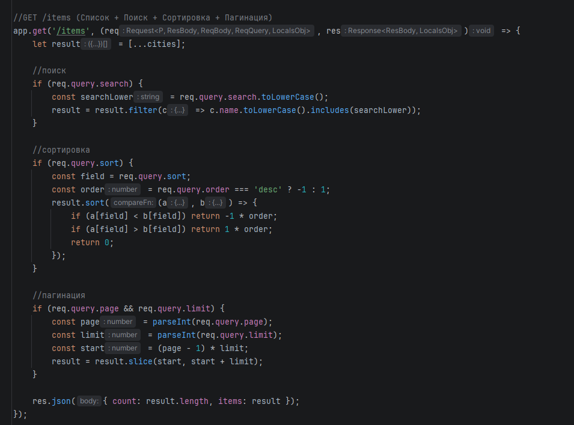
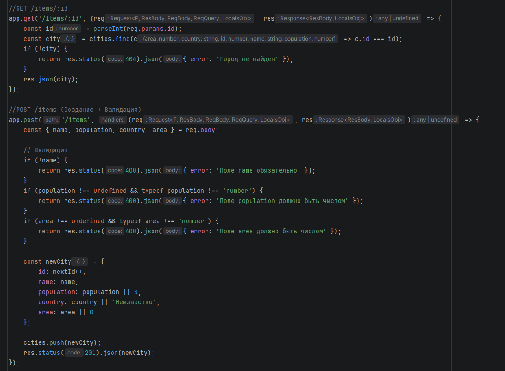
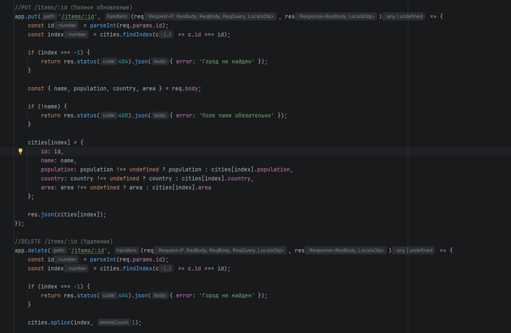
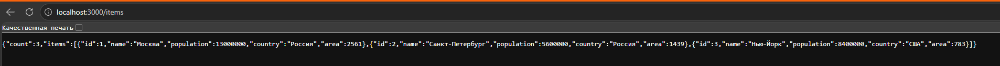
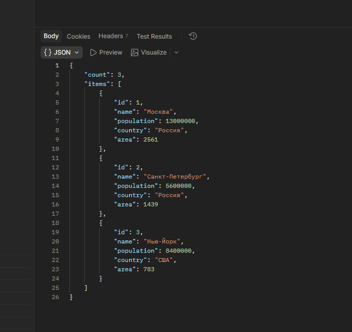
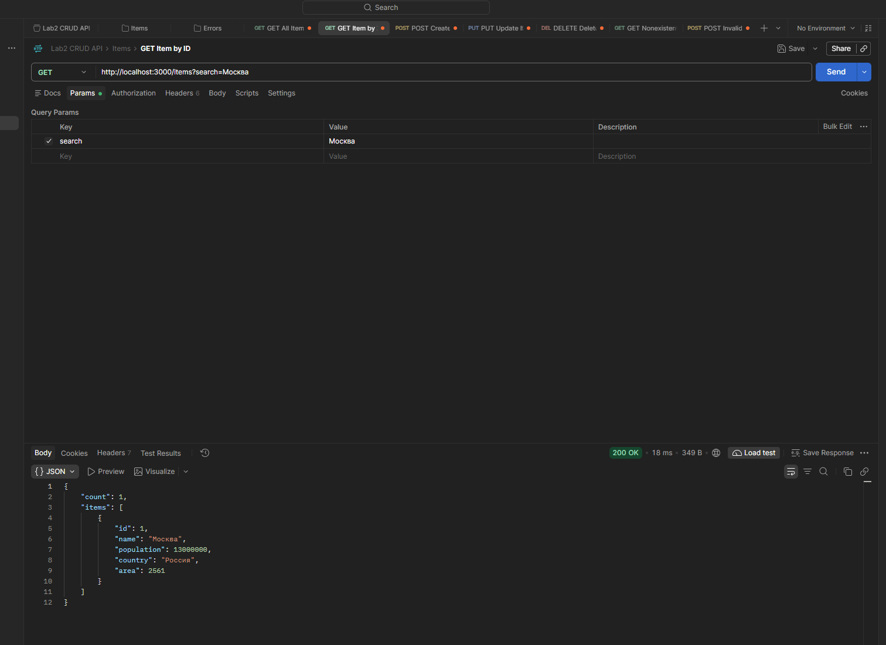
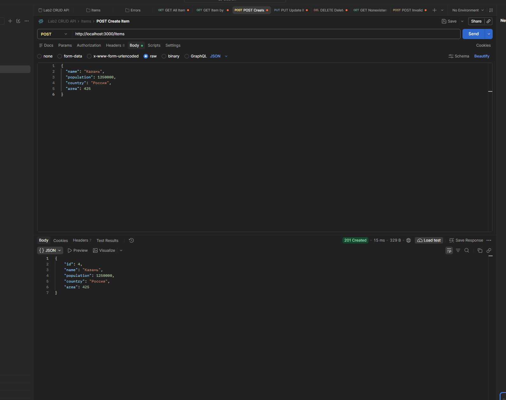
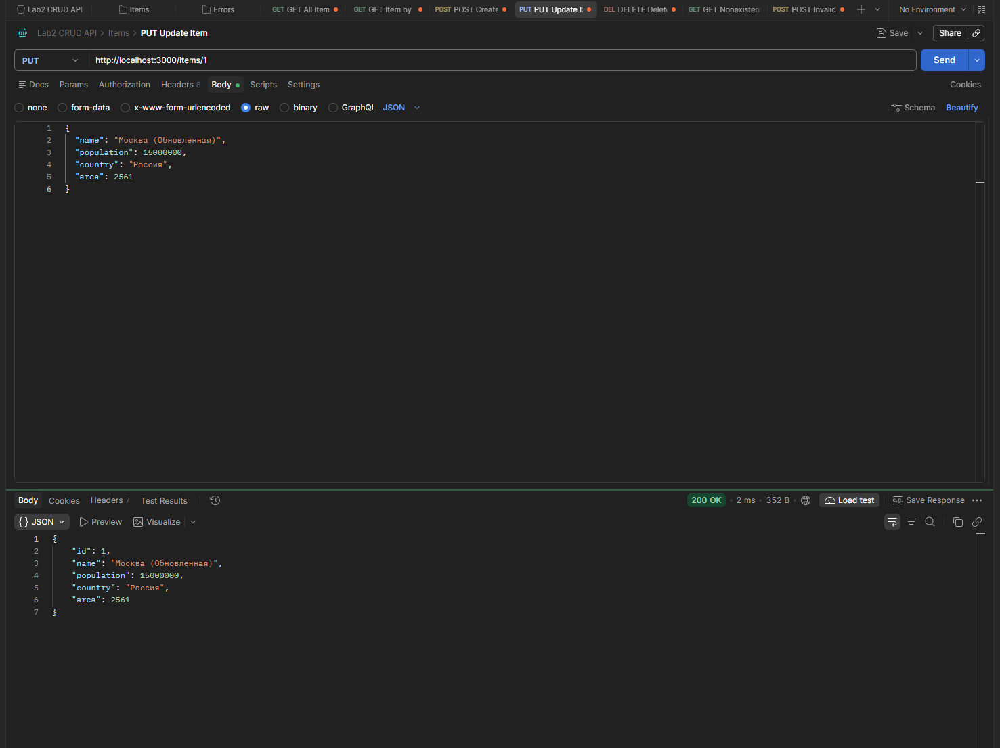
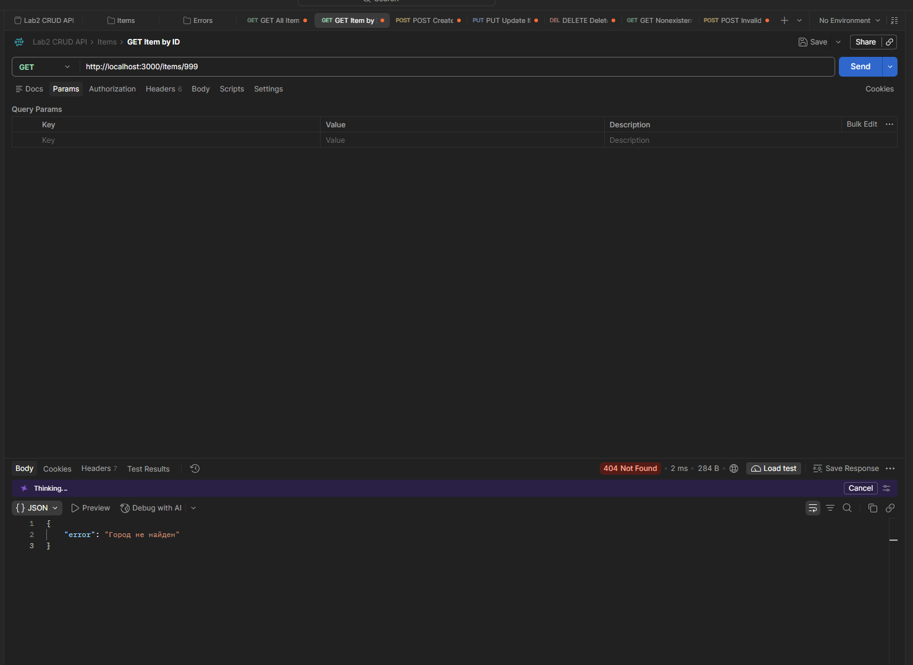

# Лабораторная работа №2: HTTP-методы: обработка GET, POST, PUT, DELETE 
 
**Студент:** Бойко Андрей Сергеевич
**Группа:** ПИЖ-б-о-25-2
**Вариант:** 7
**Технология:** Python + Flask
 
## Содержание
- [Цель работы](#цель-работы) 
- [Выполнение индивидуального задания](#выполнение-индивидуального-задания)
- [Контрольные вопросы](#контрольные-вопросы)
- [Вывод](#вывод) 
 
## Цель работы
Цель: Освоить обработку различных HTTP-методов (GET, POST, PUT, DELETE) в Express/Flask. Научиться реализовывать CRUD операции над коллекцией объектов, хранящейся в памяти сервера, а также возвращать корректные HTTP-коды ответов (200, 201, 404).

Написал простые алгоритмы поиска, сортировки и пагинации.

Добавил методы POST, GET, PUT, DELETE с валидацией.

Проверил работоспособность GET в браузере и Postman.

Убедился, что остальные методы работают.
## Контрольные вопросы
1. В чём разница между PUT и PATCH? PUT полностью заменяет ресурс переданными данными, а PATCH выполняет частичное обновление (только указанных полей).
2. Как реализовать поиск по коллекции (query-параметр search)? Использовать метод .filter() по массиву, проверяя вхождение строки в нужное поле через .includes().
3. Как реализовать сортировку по полю? Использовать метод .sort() с функцией сравнения, учитывая порядок (order=asc|desc).
4. Как реализовать пагинацию (постраничный вывод)? Использовать метод .slice(), рассчитав начальный индекс как (page - 1) * limit.
5. Как валидировать входные данные (например, что price — число)? С помощью оператора typeof (например, typeof price !== 'number') и возврата кода 400 Bad Request при ошибке.
6. Какие коды ответов используются при ошибках валидации? Используется код 400 Bad Request.
7. Как вернуть 204 No Content при DELETE? Использовать метод res.status(204).send() без передачи тела ответа.
8. В чём разница между res.json() и res.send()? res.json() автоматически устанавливает заголовок Content-Type: application/json и отправляет объект, а res.send() отправляет данные в исходном виде (строку, буфер).
9. Как избежать дублирования ID при создании новых элементов? Использовать отдельную переменную-счётчик (например, let nextId = 4;), которая увеличивается после каждого создания.
10. Что такое express.json() и почему без него req.body пустой? Это встроенный middleware, который парсит JSON из тела запроса; без него Express не может преобразовать строку в объект, и req.body остаётся пустым.
##Вывод
Вывод: Освоили обработку различных HTTP-методов (GET, POST, PUT, DELETE) в Express/Flask. Научились реализовывать CRUD операции над коллекцией объектов, хранящейся в памяти сервера, а также возвращать корректные HTTP-коды ответов (200, 201, 404).
